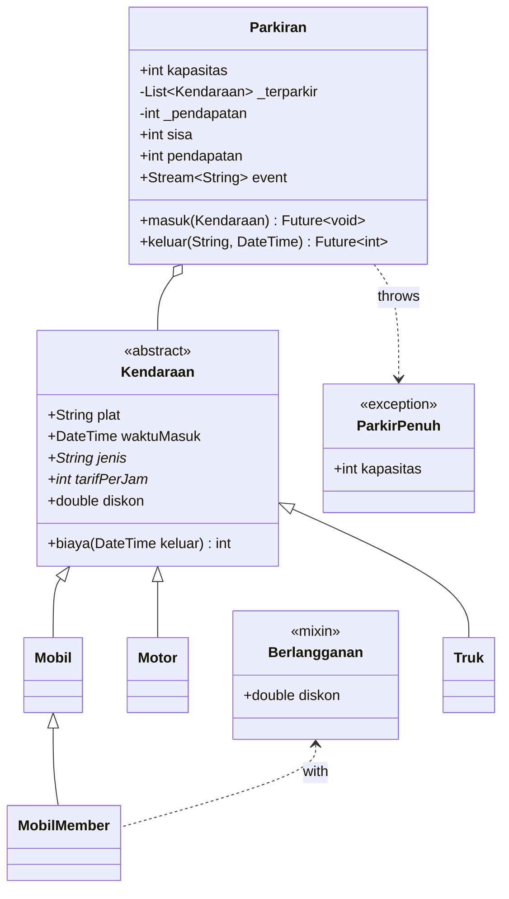
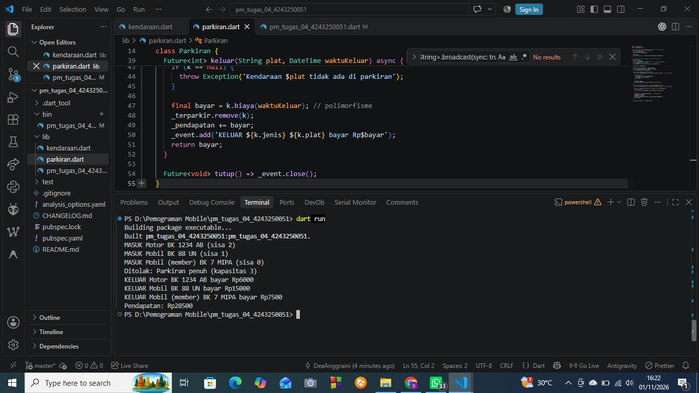

# Tugas Rutin 4: Sistem Parkir Kampus (Console)

## Identitas
- Nama: Dea Anggraini
- NIM: 4243250051
- Kelas: PSIK 24 C
- Mata Kuliah: Pemrograman Mobile (3KOM40215), Pertemuan 4

## Diagram Kelas

## Tangkapan Layar Keluaran

## Penjelasan
Enkapsulasi diterapkan pada class Parkiran: daftar kendaraan `_terparkir`, total `_pendapatan`, dan `_event` diberi awalan garis bawah sehingga tidak bisa diubah langsung dari luar berkas. Akses hanya lewat getter `sisa` dan `pendapatan` serta method `masuk` dan `keluar`. Polimorfisme diterapkan pada class abstrak Kendaraan. Motor, Mobil, Truk, dan MobilMember menimpa getter `jenis` dan `tarifPerJam`, sedangkan mixin Berlangganan menimpa `diskon`. Di `main`, satu `List<Kendaraan>` berisi berbagai jenis kendaraan, dan method `biaya()` otomatis memakai tarif sesuai objek aslinya. Async diterapkan pada `masuk` dan `keluar` yang memakai `Future.delayed` untuk mensimulasikan palang otomatis, lalu dipanggil dengan `await` di `main`. Setiap kejadian dikirim lewat `StreamController.broadcast()` dan ditampilkan listener yang mewakili layar pos jaga. Kapasitas penuh ditangani dengan exception kustom `ParkirPenuh`.

## Pernyataan Penggunaan AI
Saya menggunakan Claude untuk membantu memahami struktur tugas dan menyusun draf kode. Kode sudah saya jalankan, uji, dan pahami sendiri.